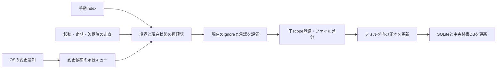

# 12 Change Detection

登録ルートの変更検知と欠落からの回復を定める。watch と user service の操作は
[CLI 契約](06-cli-spec.md#v1-foreground-watch)、製品としての受入は
[製品要求](11-product-requirements.md#3-受入) に従う。

## 1. 方針

登録ルートを OS の変更通知で監視し、変更候補となったディレクトリとファイルだけを再確認する。
イベント、手動 `index`、起動時・定期・障害復旧時の走査は、同じ reconciliation engine に入力する。
ignore されない新規フォルダは空でも `.kio` を持つ独立 scope とする。ルート登録時の権限は、
このローカル管理範囲を継続して管理する権限として明示する。外部送信承認は別に扱う。

イベントは「再確認すべき場所」の情報であり、ファイルの正本、変更内容そのもの、操作の許可証ではない。
変更通知一件ごとにコミットしたり、LLM を呼び出したりしない。重複通知をまとめ、現在の安定した内容を
確定してから、ローカル保存、必要な派生物の生成、承認済みの外部処理を順に行う。

## 2. 各 OS の使い分け

| OS | 基本となる通知 | 復旧上の注意 |
|---|---|---|
| macOS | FSEvents。必要な粒度に合わせて file events を利用 | 通知の集約や `MustScanSubDirs` では対象 subtree を再走査する。drop 発生時は監視対象を再照合し、保存した event ID を無条件に信用しない |
| Linux | inotify。既存の対象ディレクトリごとに watch を登録 | 再帰監視はアプリ側で構成する。新規・移入ディレクトリは watch 登録と直後の走査が必要。`IN_Q_OVERFLOW`、watch 上限、停止中の欠落は再走査で復旧する |
| Windows | `ReadDirectoryChangesW` の subtree 監視 | バッファ欠落、戻り値の byte count が 0、`ERROR_NOTIFY_ENUM_DIR` では再列挙する。NTFS USN Journal は利用可能な場合の再開最適化に限定する |

Apple はイベントとディレクトリ階層のメタデータ snapshot の併用を説明している。
FSEvents の履歴は再開に役立つが、欠落時の再走査を省く根拠にはならない。
[Apple FSEvents](https://developer.apple.com/library/archive/documentation/Darwin/Conceptual/FSEvents_ProgGuide/UsingtheFSEventsFramework/UsingtheFSEventsFramework.html)

inotify は非再帰で、rename の対が常に隣接するとは限らず、新しい watch の登録前に変更が起こり得る。
通知の件数をファイル更新回数やコミット履歴として解釈しない。
[Linux inotify](https://www.man7.org/linux/man-pages/man7/inotify.7.html)

Windows の通知欠落時には subtree の列挙が必要になる。USN は NTFS volume の変更理由を記録するが、
ファイルの過去の内容を保存する履歴ではなく、削除・再作成された journal を継続扱いできない。
[ReadDirectoryChangesW](https://learn.microsoft.com/en-us/windows/win32/api/winbase/nf-winbase-readdirectorychangesw)、
[Change Journal Records](https://learn.microsoft.com/en-us/windows/win32/fileio/change-journal-records)、
[Journal lifecycle](https://learn.microsoft.com/en-us/windows/win32/fileio/creating-modifying-and-deleting-a-change-journal)

Windows は通常 directory 自体の名前・サイズ・更新日時系の `Modified` 通知に限り、観測に成功した場合の自己通知を
抑止できる。制御ファイル、file、reparse point、観測失敗、作成・削除・rename、属性・security の通知を
抑止しない。どちらかの通知系統が失敗した場合は能力低下を表示し、root を再照合する。
停止時は未完了 I/O の取消しと監視 worker の終了を確認してから監視資源を解放する。

永続 cursor は volume identity、journal identity、root identity と組にする。Linux の inotify watch ID は
永続 cursor として保存しない。OS 共通 API はイベントだけでなく、`rescan_required`、監視範囲、
継続性、backend failure を表現する。ネットワーク共有や仮想ファイルシステムでは、通知能力を検出して
polling に切り替え、低下した検知能力と最終照合時刻を利用者に表示する。

## 3. サイズ・更新日時・更新履歴の位置付け

- ディレクトリ自身のサイズは、配下のファイル容量の合計や subtree fingerprint ではない。
  フォルダの更新日時だけで、その下にある既存ファイルの内容変更を検知できるとは限らない。
- ファイルの identity、size、mtime、利用できる ctime/change information は高速な差分候補抽出に使う。
  同一サイズへの上書き、mtime の保存、時計粒度、ID の再利用を考慮し、一致を内容同一の証明にしない。
- 内容が変わったかの最終確認には、安定した読み取りで得た bytes の content hash を使う。
  読み取り前後で identity・metadata が変わった場合は再試行し、混在した内容を snapshot に採用しない。
- Kio が保持する subtree 集計サイズや Merkle digest は有用な派生情報だが、子の変更が漏れた場合には
  同じく古い値になる。OS に常時維持された完全な subtree digest が存在する前提にはしない。

ファイルサイズと時刻のフィールドは OS のメタデータであり、内容 hash と別の意味を持つ。
[POSIX stat fields](https://www.man7.org/linux/man-pages/man0/sys_stat.h.0p.html)

通常はイベント候補に絞って hash を再計算する。通知継続性を失った場合は安全に再走査する。
metadata が完全一致していても内容が変わるケースまで回復を保証するには、必要な範囲の再 hash が必要である。
周期的な整合性確認は負荷を分散できるが、metadata-only 走査で完全性を保証したとは表示しない。

OS の更新履歴は「何かが変わった」情報であり、Kio の immutable commit 履歴の代わりにはならない。
短時間に作成後削除され、一度も安定状態として取り込めなかったファイルまで保存する保証は別要件である。

## 4. 再照合と中断からの復旧

| 設定 | 既定値 |
|---|---:|
| 通知の debounce | 250 ms |
| 通知連続時の最大待ち時間 | 2 s |
| 完全再照合の間隔 | 300 s |
| root ごとの保留 path ヒント上限 | 4,096 |

起動、監視再接続、sleep 復帰後の継続性不明、通知欠落、backend error、queue overflow、権限変更、root 移動、
定期照合で完全再照合する。root の実体と管理許可を確認して監視を開始し、初回・復旧走査の間に届いた通知も
保留して走査後に再照合する。Linux ではディレクトリごとの監視登録直後にも内容を確認して登録前後の変更を
回収する。rename の対の一方が欠ければ旧親・新親の現在状態から判断し、更新が続く不安定なファイルは再試行する。

照合中に届いた通知を先行処理の成功で消さず、未完了の変更は可視のままキューに残す。正本更新と派生処理は
冪等とし、再処理に必要な意図を耐久化した後で cursor を進める。壁時計の変更で定期照合を省略しない。
queue・state は監視 root 外の owner-private device storage に置く。queue・cursor・inventory は
消失時に `.kio` と実ファイルから再照合できる運用状態とし、承認の正本を置かない。

毎回、現在の端末設定、保持済みの root 実体、管理権限、Ignore を再検証する。HEAD・manifest・lock・task を
含む `.kio` 生成物の変更を自己通知として除外する。管理・policy・設定・承認の変更は完全再照合を起こす。
通知 path を候補として、保持済み directory handle と現在の実体で検証し、root 外への移動、symlink、
reparse point、mount 境界、Ignore を確認する。
内容は関連する bytes の hash で確定する。watch は offline で、外部 job の poll・download・cleanup
を行わない。loopback は [Adapter の送信境界](07-adapter-spec.md#31-ローカル窓の送信境界) に従う。

同じ root の watcher は OS file lock で一つに限る。status は読み取り専用で、観測時刻を表示し、保存値だけで
現在の稼働を判定しない。stop は PID ではなく現在の instance を指定し、稼働中の照合が終了してから止まる。
scheduler への登録と実行では、他の利用者が書き換えられず、祖先ディレクトリ経由でも
置き換えられない実行ファイルを要求する。条件を満たさない場合は権限を修復せず拒否する。
service manifest、lock、queue、state は [Kio 作成物の保護](10-operations.md#43-kio-created-object-boundary) に従う。

## 5. スコープと送信承認

子 scope の自動作成は root の明示的なローカル管理許可を継承できる。新規子への外部送信を自動的に許可するかは
独立の egress policy である。既定では自動付与しない。将来、配下への送信許可を導入するなら、適用範囲、
provider/profile、将来作成される子への適用、失効を利用者に明示した別の承認とする。

Ignore の変更は既存子にも適用する。新規発見を止めるだけでは不十分であり、検索の可視性、保留タスク、
送信直前の再検証を同じ現行 policy に結び付ける。parent policy の世代と child の適用世代を照合し、
失効を先に公開してから非同期に projection を更新する。これにより失効処理中の古い許可の使用を防ぐ。
移動・切断で policy の出所を検証できない場合は、少なくとも外部送信を停止し、明示的な再登録で解決する。

通常の知識走査とイベント対象から `.kio` の生成物を除外する一方、`.kioignore`、policy/config/consent の変更は
専用の制御通知として監視する。自分自身の DB 書き込みを契機に無限再実行しないよう、制御対象と生成物を区別する。
時刻だけで一括して通知を捨てる方法は、同時に起きた利用者の変更まで落とすため採用しない。

symlink/junction と未登録の mount 境界を既定で越えない。別 volume を対象とする場合は root として明示登録する。
Unix の device ID だけでは同一 filesystem の bind mount を区別できないので、各 OS の mount 情報も必要になる。
通知 API の実装だけでは安全な `.kio` 更新の証明にならない。Windows の保存・回復経路も、
現行候補の実装と最終 native 受入を分けて検証する。

## 6. v1 の検証と次の改善

3 OS で、空フォルダ、新規・変更・削除・rename・移入、深い subtree、同サイズ上書き、mtime 保存、Ignore の
追加・解除、既存子の失効、root 移動、監視 overflow、watch 上限、停止・再起動、処理途中 crash を検証する。
自動処理と手動 `index` が同じ最終状態に収束し、承認なしの外部通信が発生しないことを確認する。
OS 固有 integration test と、通知の欠落・重複を注入する共通 engine test の両方が必要である。

継続プロセスの CLI とログインユーザーの native service lifecycle は [06-cli-spec.md](06-cli-spec.md) に
定義され、実装されている。各 OS の native lifecycle と最終候補の受入結果は進捗記録で個別に判定する。

次の改善では、scope 全体の watch 状態に加えて、ファイルの版・内容 hash に紐付く原本保存、抽出、
全文検索、embedding の準備状態を利用者が確認できるようにする。これらを単一の完了率にまとめず、
例えば原本保存済みで OCR 承認待ち、全文検索可能で embedding 未作成、旧版は検索可能で最新版は
処理中という違いを表す。状態表示の追加は保存・検索正本の変更や 3 OS 受入完了を意味しない。
具体的な受入条件と順序は [実装計画](../tasks/knowledge-ux-implementation-plan-2026-10-03.md) に置く。

watch も embedding の共通 Task pipeline（[04-pipeline.md §5](04-pipeline.md)）を使い、
watch 専用の local executor を作らない。モデルは暗黙取得せず、未準備理由を表示する。
取得と device 状態の境界は [10-operations.md §5.1](10-operations.md) に従う。
