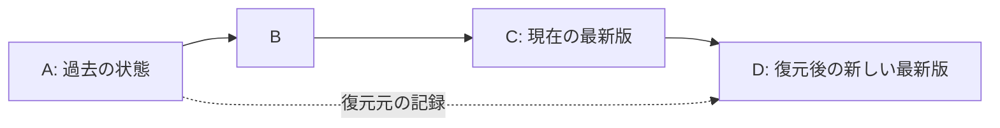

# 13 Linear History and Restore

線形履歴と管理対象の復元を定める。保存形式は [データモデル](03-data-model.md#2-kio-物理レイアウト)、
操作の詳細は [CLI 契約](06-cli-spec.md#5-export) に従う。

## 1. 過去の状態を新しい commit として採用する



D の唯一の親は C である。A は復元元の provenance として記録し、第二の親にしない。
HEAD を A に戻したり B/C を消したりしない。D の後も E、F と一本の履歴を継続する。
この構造はフォルダ全体の状態復元と、選択ファイルの復元の両方で使える。

| 操作 | D の内容 | 他のファイル |
|---|---|---|
| scope の状態復元 (`--path` 省略) | 現行 policy が許す A の raw ファイルを採用する。C にだけ存在するファイルは既定で削除しない | 明示した `--delete-missing` 以外は維持。子 scope は対象外 |
| 選択パスの状態復元 | C を基礎に、明示したパスだけを A の内容に置き換える | 選択していないパスは維持 |
| commit の差分の打消し | 指定 commit の変更を逆適用する | 後続の変更との競合処理が必要。状態復元とは別の操作 |

PDF・画像・Office を主に扱う Kio では、状態復元の結果を説明しやすい。
Git の `revert` は変更の逆適用を新 commit にする操作であり、過去 snapshot の採用と同一ではない。
CLI を `revert` と呼ぶならこの違いを曖昧にしない。
[Git revert](https://git-scm.com/docs/git-revert)、[Git restore](https://git-scm.com/docs/git-restore)

## 2. 現行 CLI

過去の原本を別場所へ書き出す操作は `export`、管理中の状態を過去版から新しい子 commit として
採用する操作は `restore` である。詳細な引数・拒否条件は [06-cli-spec.md §5](06-cli-spec.md) に従う。

```text
kio export <commit> --to <directory>
kio restore <source> --preview
kio restore <source> --path report.pdf --path notes.md --preview
kio restore <source> --path report.pdf --expected-head <current-commit> --message "restore report"
kio restore <source> --delete-missing obsolete.md
kio repair recover-restore
```

`source` は `HEAD`、full commit hash、tag を受け付ける。`--path` 省略時は source tree のうち
現在の管理・ignore policy が許す path を戻す。source に存在しない current-only file は自動削除せず、
削除対象は `--delete-missing` で明示する。preview は読み取り専用で、適用時は HEAD と対象の
working bytes・identity を再検証する。`--expected-head` は preview 時の HEAD を適用時に固定できる。

管理中の未保存変更や未管理ファイルを黙って上書きしない。現在と同じ内容を選んだ場合は no-op とする。

## 3. 線形形式の不変条件

- commit は単一の `parent` を必須とする。genesis は `null`、それ以外は公開時に観測した current HEAD を指す。
- HEAD は唯一の可変履歴参照である。最初の snapshot 前は `unborn` と LF、それ以降は commit hash と LF を保存する。
  欠落、空、不正な HEAD はエラーとし、他の参照や CAS から推測して補わない。
- tag は一本の chain 上の commit を指す論理名である。削除は ref だけを解除し、HEAD・CAS と名前の監査行を保持する。
  切断した別履歴を新しい公開 root として認めない。タグ作成・取り込んだタグの読取・台帳由来の
  rebuild root は、現在の HEAD から parent を逆にたどって到達できることを検証する。
  未公開の子 commit と unborn HEAD に残ったタグも拒否し、タグから HEAD を推測して復旧しない。
  shallow 化済みの版に後から tag を付けて元 bytes を回復することはできない。
- 復元 commit は `restored` の typed metadata に復元元と選択パス等の provenance を記録し、
  現在の HEAD を唯一の親にする。復元元は同 scope の過去に限定する。
- 「親としてたどる辺」と「監査のための参照」を区別する。復元元への参照を無期限の GC pin とすると
  purge/retention を壊す。復元 provenance は元の引用を保持する pin ではない。
  HEAD/tag の tip は retention GC の shallow 候補外だが、明示的な purge/erase を防がない。
- 旧形式と `parents` 配列は変更前に拒否する。旧形式の reader や互換 alias は要件にしない。
  ただし旧 `.kio` や利用者ファイルを自動削除しない。必要な知識の export/import は明示操作として扱う。

## 4. 復元 transaction

復元は現在の HEAD、source closure、raw object の存在と hash、purge、policy、対象ファイルの変更や衝突を
検証して、scope 直下の管理対象だけを確定する。適用時は scope lock 下で HEAD と対象の実体を再検証する。
複数の作業ファイルが他のアプリから同時に切り替わることは保証しない。

原本は有界メモリで扱い、64 MiB/file・512 MiB/operation の固定拒否を設けない。
変更前に、同一ファイルシステム内の private stage の実体・digest・長さ、前後の状態と進行段階を
回復用 journal に耐久記録する。journal に本文は埋め込まない。
中断後は全 bytes と digest を検証できた stage だけを再使用し、検証済みの進行段階から再開または巻き戻す。
置換・削除は保持済み実体に限定し、リンクをたどらない。作業ファイルの件数・bytes と耐久化済み段階を表示する。
適用中の読み取りでは該当 scope を除外するか busy とし、古い検索結果を最新版として返さない。

通常の履歴公開も、immutable object と回復用 journal を耐久化してから、観測した親を条件に HEAD を進める。
HEAD 公開後に manifest を反映し、その後に journal を外す。中断時は記録した親と commit を照合し、
読み取り専用操作は公開を修復しない。復元の中断は `kio repair recover-restore` が journal と現行 HEAD を
照合して処理する。journal が残る間は通常操作を拒否し、部分的に置換された作業ファイルから完了を推測しない。

復元済みの原本・履歴と、再構築できる SQLite・検索 replica の状態を分けて報告する。
派生索引が失敗しても公開済み HEAD を巻き戻さず、検索不能な状態を明示する。
復元を理由に Adapter や外部送信を使う再処理を暗黙に始めない。
`export` と `restore` は `.kio`、`.kioignore`、管理・承認・設定・課金状態を原本として適用しない。

過去の raw 内容を採用しても、現在の ignore、送信承認、tool 設定、予算、課金台帳、保留タスクを巻き戻さない。
device の model/runtime/取得同意は knowledge snapshot から継承・復元しない
（[10-operations.md §5.1](10-operations.md)）。保存済み image receipt と producer provenance は
[03-data-model.md §7 / §8.1](03-data-model.md) に従って検証し、OS 移動だけで vector を再生成しない。
旧 Markdown/embedding は raw identity と現行 profile の互換性を検証できるときだけ再利用する。
不適合な派生物は再生成対象にし、外部処理はその時点の承認を必要とする。purged/shallow な元データが
欠ける場合は理由付きで拒否し、履歴復元を暗黙の resurrection にしない。

## 5. フォルダ配下全体と v3

一つの `.kio` はそのフォルダの直下を管理する。親の「全体復元」は子 scope の過去を決めない。
配下全体の復元を提供する場合は、scope ごとの current HEAD と復元元を固定した coordinator plan が必要になる。
親 commit 時刻から子の版を勝手に推測せず、必要なら root checkpoint に scope→commit 対応を保存する。
別 volume をまたぐ全体 atomicity は保証せず、scope ごとの成功・失敗・未適用と再開方法を示す。

v3 でも canonical history を一本に保つことは可能である。サーバーで expected HEAD を比較し、古い状態からの
同時更新には競合解決を要求する。共同編集で CRDT 等を採用しても、その編集状態を確定して一つの子 commit を
発行できる。これは将来の設計選択であり、今から多親 commit を必要とする理由ではない。

共有時は tenant/principal、scope identity、current policy の境界を追加する。同じ content hash を同じ権限の
証拠にせず、復元・検索・replication のすべてで所属と可視性を確認する。共有された `.kio` の承認記録だけで
受信側端末の外部送信許可を成立させない。

## 6. 復元の受入

同一候補をローカルと 3 OS で検証する。複数親・別 HEAD の拒否、復元元にないファイルの既定保持と
明示削除、非選択パスの保持、未保存変更、復元元にない選択パス、purge、派生索引の不整合、policy の非復活、
HEAD の競合、各段階での中断と回復を含める。
v2 GUI は export と管理中の状態復元を区別して表示し、CLI と同じ計画・競合・回復結果を利用する。
